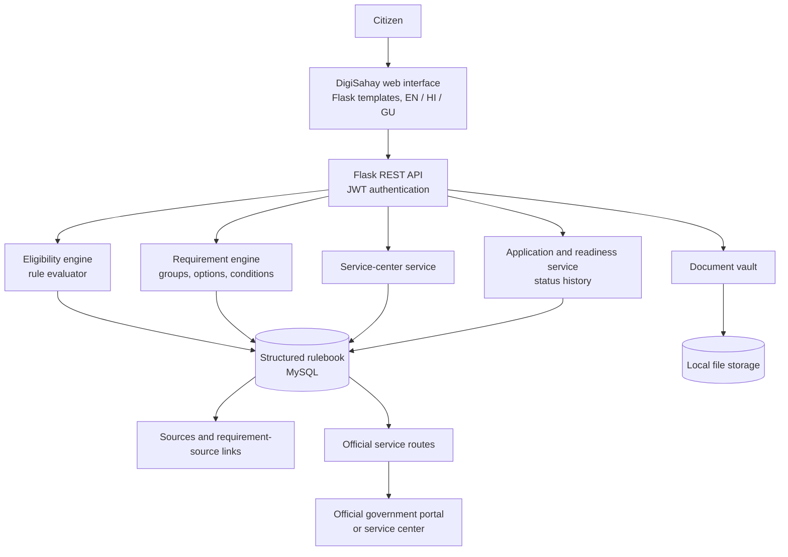
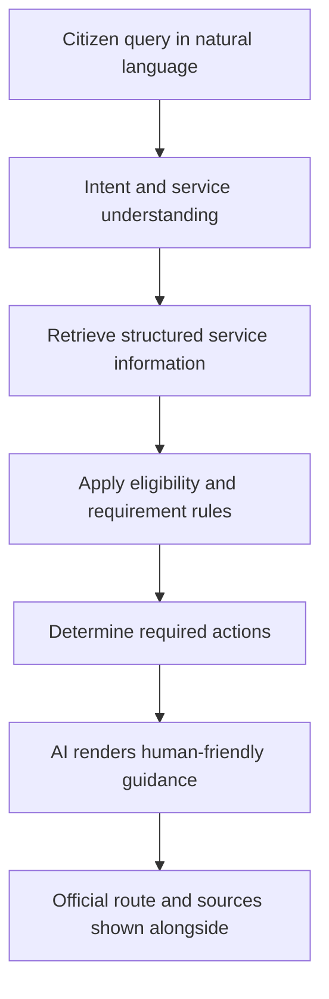
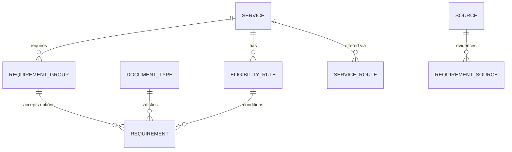
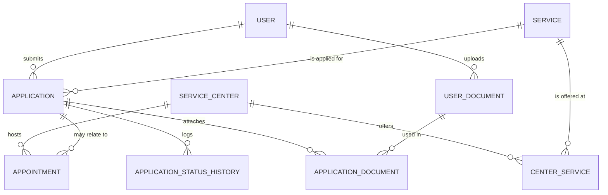
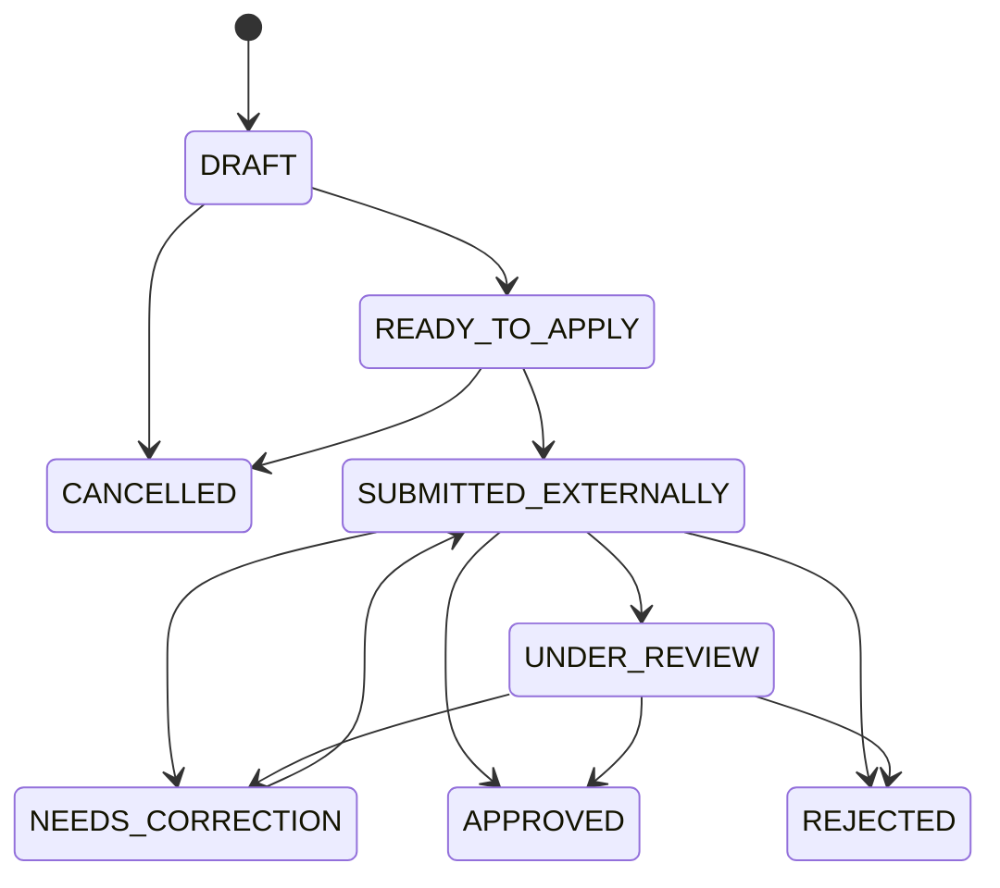

# DigiSahay

**A citizen-journey guidance layer for Indian government services: understand the service, check eligibility, prepare documents, find the official route, apply, and track.**


> DigiSahay is an independent academic project. It is **not** a government platform, is **not** affiliated with UIDAI, the Election Commission of India, or the Income Tax Department, does **not** issue Aadhaar, PAN, or Voter ID, and does **not** submit applications to any government system.

---

## Contents

1. [Overview](#overview)
2. [The problem](#the-problem)
3. [Research-backed motivation](#research-backed-motivation)
4. [What DigiSahay does](#what-digisahay-does)
5. [Implementation status](#implementation-status)
6. [System architecture](#system-architecture)
7. [Rules-first guidance architecture](#rules-first-guidance-architecture)
8. [Rulebook and knowledge architecture](#rulebook-and-knowledge-architecture)
9. [Database architecture](#database-architecture)
10. [Government integration boundary](#government-integration-boundary)
11. [Privacy and security](#privacy-and-security)
12. [Phase 1 service coverage](#phase-1-service-coverage)
13. [Example user journey](#example-user-journey)
14. [What makes DigiSahay different](#what-makes-digisahay-different)
15. [Technology stack](#technology-stack)
16. [Repository structure](#repository-structure)
17. [Running locally](#running-locally)
18. [API overview](#api-overview)
19. [Known limitations](#known-limitations)
20. [Roadmap](#roadmap)
21. [Team](#team)
22. [References](#references)
23. [Disclaimer](#disclaimer)

---

## Overview

Indian government services are split across separate bodies and portals (UIDAI, the Election Commission, the Income Tax Department, state civil registration offices), each with its own forms, document lists, and offices. DigiLocker stores documents digitally, but it does not tell a citizen what they need *before* applying.

DigiSahay organizes the process around **the service the citizen needs**, not around the department that handles it:

```text
Understand → Check eligibility → Prepare documents → Find where to apply → Apply → Track → Complete
```

It works as a **guidance and orchestration layer around official services**. Eligibility and document requirements come from a structured, source-linked rulebook. Where no government integration exists, DigiSahay hands the citizen off to the official portal or office.

## The problem

A citizen applying for a document today typically:

- does not know which supporting documents are needed first,
- does not know which office handles the service,
- discovers a missing document only at the counter,
- waits, returns, and re-enters the same personal details across applications,
- and tracks each application in a different place.

DigiSahay's design targets each of these failure points.

## Research-backed motivation

The design is grounded in a team-run user survey, **"Government Document Process – User Problems Survey"** (online questionnaire, 24 Sep – 1 Oct 2026).

| Property | Value |
|---|---|
| Valid responses | **55** (56 submissions; one duplicate removed) |
| Respondent profile | Students and young adults; 89% aged 18–19; mostly Ahmedabad, Gujarat |
| Sampling | Convenience sampling through the team's networks |
| Questionnaire | 4 background and 15 experience questions |

| Finding | Result |
|---|---|
| Caught off guard by a missing supporting document | **73%** (40 of 55) |
| Visited the wrong office at least once | **40%** (22 of 55); a further 22% were unsure |
| Found the right center via the official government website | 20% (11 of 55) |
| Waited one hour or more at a center | **75%** |
| Needed two or more visits for one process | **75%** |
| Had an application rejected or sent back | **42%** (23 of 55) |
| Re-entered the same personal information across applications | **96%** (49% often, 47% sometimes) |
| Said a unified platform would be useful | **91%** (58% very useful, 33% somewhat useful, 0% not useful) |

Among free-text rejection reasons, the most common were name mismatches across documents (6 respondents), form-filling mistakes (4), and missing supporting documents (3).

**Read these figures with care.** The sample is small, drawn from one age group and one region, self-reported, and measures problems and interest in the idea rather than the performance of a working system. The results cannot be generalized to the whole country. Percentages are rounded to whole numbers.

> An earlier draft of the report used a 50-respondent sample with slightly different numbers (e.g., 76% for the missing-document finding). This README uses the final 55-respondent analysis throughout.

## What DigiSahay does

| Capability | Purpose |
|---|---|
| Service guidance | Help a citizen find the right government service and see its form, authority, and official portal |
| Eligibility checker | Evaluate structured rules (citizenship, age on a qualifying date, and similar) deterministically |
| Prerequisite / document checker | Show which documents are required, which alternatives are accepted, and under what conditions |
| Service-center locator | List centers that actually support the selected service, not generic office pins |
| Official application routes | Show online, offline, or hybrid routes with official URLs and instructions |
| Application tracking | Keep an application's lifecycle and status history in one place |
| Readiness check | Compare attached documents against the requirements before the citizen goes to apply |
| Document vault | Keep uploaded documents per user and attach them to applications |
| Multilingual interface | English, Hindi, and Gujarati UI strings |

## Implementation status

Features are labelled by what the repository actually contains. This table reflects the code and data at the time of writing.

| Capability | Status | Notes |
|---|---|---|
| Structured rulebook (services, rules, requirement groups, documents, routes, sources) | **Implemented** | Excel workbook plus import script into MySQL |
| Eligibility evaluation | **Implemented** | `BOOLEAN_EQUAL` and `AGE_COMPARE` condition types |
| Requirement evaluation (selection modes, conditional groups and options) | **Implemented** | `POST /api/services/<id>/requirements/evaluate` |
| Prerequisite checker UI | **Implemented** | `/prerequisite-checker` |
| Service-center listing filtered by service, district, city, pincode | **Implemented** | Center–service mapping; Gujarat prototype data |
| Official routes with `integration_status` | **Implemented** | All routes currently `NOT_INTEGRATED` |
| User accounts (register, login, JWT) | **Implemented** | Password hashing, 30-minute access tokens |
| Document upload, list, download, replace, delete | **Implemented** | PDF, JPG, JPEG, PNG; 5 MB limit |
| Applications, attached documents, status history | **Implemented** | Controlled status transitions, see below |
| Application readiness check | **Implemented** | Missing-requirement detection against the rulebook |
| English / Hindi / Gujarati interface | **Implemented** | `static/js/translations.js` |
| Appointment records | **Prototype** | Read endpoints and data model; booking happens on the official portal |
| Natural-language / LLM guidance | **Proposed** | No LLM integration exists in the repository yet |
| Geospatial "nearest center" ranking and map view | **Proposed** | Coordinates are stored; no distance logic or map UI yet |
| Reminder engine (deadlines, renewals, expiry) | **Proposed** | Not implemented |
| Auto-fill from saved documents | **Proposed** | Not implemented |
| Rejection-reason prediction (name mismatch, expired documents) | **Proposed** | Only missing-requirement detection exists today |
| Live wait-time / crowd estimates | **Future** | Requires data from centers |
| SMS fallback, family profiles, life-event bundles, voice-guided forms | **Future** | From the project report's suggested features |
| DigiLocker / government API integration | **Future** | Not present; see [integration boundary](#government-integration-boundary) |

## System architecture



The same flow, read top-down:

```text
Citizen
   ↓
DigiSahay interface
   ↓
Eligibility engine + Requirement engine
   ↓
Structured rulebook / knowledge database
   ↓
Documents + Requirements + Sources
   ↓
Official service routes
   ↓
Government portal / service center   ← hand-off, not integration
```

Supporting layers:

| Layer | Role | Status |
|---|---|---|
| Authentication | Registration, login, JWT-protected endpoints | Implemented |
| Privacy | Data-minimization boundary (see below) | Design principle; partially enforced |
| Service-center / geospatial | Center–service mapping; coordinates stored | Mapping implemented; geospatial ranking proposed |
| Application tracking | Lifecycle states and audit history | Implemented |
| Reminders | Deadline, renewal, expiry alerts | Proposed |
| AI guidance layer | Natural-language interaction | Proposed |

## Rules-first guidance architecture

DigiSahay follows a **rules-first, AI-guidance** principle:

> AI must not invent government requirements. Reliable decisions come from structured, source-linked rules; AI's role is to understand the citizen's request and explain the result in plain language.

```text
Government source → Structured rulebook → Rule engine → AI explanation
```

The intended interaction flow:



**Status:** the deterministic middle of this pipeline (retrieve → rules → required actions) is implemented. The natural-language front end and AI explanation layer are **proposed** and are not in the repository yet. When added, the model's output is meant to be constrained to rulebook data, with the rule engine, not the model, deciding eligibility.

## Rulebook and knowledge architecture

The rulebook (`data/DigiSahay_rulebook (1).xlsx`) is a normalized, relational knowledge base. Each record carries a `verification_status`, and rules and requirements are linked to primary sources, so every claim can be traced to an official document.

| Table | Purpose |
|---|---|
| Services | Registry of services and application variants (form, authority, official URL) |
| Eligibility Rules | Atomic, deterministic criteria with a typed JSON condition and outcomes |
| Requirement Groups | Logical groups of requirements (e.g., age proof, photograph) with a selection mode |
| Document Types | Master dictionary of accepted documents and their constraints |
| Requirements (options) | Junction of groups to accepted document types, optionally conditional |
| Submission Routes / Service Routes | Online, offline, and hybrid access channels with official URLs |
| Sources | Primary sources: forms, portals, FAQs, with check dates |
| Requirement Sources | Traceability links from rules, requirements, and services to sources |
| Archive – Original | Preserved original research for auditability |
| Service Centers, Center Services, Appointments, Applications | Gujarat prototype extensions for delivery and tracking |

**Selection modes** for requirement groups: `ALL` (every item mandatory), `CHOOSE_ONE` (exactly one accepted option), `OPTIONAL`, and `CONDITIONAL` (required only if a rule applies).

**Verification statuses:** `VERIFIED`, `PENDING_VERIFICATION`, `OUT_OF_SCOPE`, `REJECTED`.

Current workbook contents (rulebook checked against official sources on 2026-10-27):

| Item | Count |
|---|---|
| Services | 16 (9 active and verified, 7 out of scope for Phase 1) |
| Eligibility rules | 19 |
| Requirement groups | 19 |
| Document types | 26 |
| Requirement options | 69 |
| Service routes | 11 (5 online, 4 hybrid, 2 offline) |
| Sources / source links | 15 / 27 |
| Service centers | 7 (6 verified in Gujarat, 1 demo-only) |
| Center–service mappings | 19 |

**Example: Voter ID (Form 6).** Rather than answering "apply using Form 6," the rulebook models the new-registration service with a citizenship rule, an age rule evaluated against the next qualifying date (1 Jan, 1 Apr, 1 Jul, 1 Oct), and requirement groups for age proof, residence proof, and a photograph. Each group lists the accepted alternatives, such as a birth certificate or Aadhaar for age proof.

## Database architecture

Core service-knowledge chain:



Delivery and tracking chain:



In prose:

```text
Service → Eligibility Rules → Requirement Groups → Document Types → Submission Routes → Official Sources
Service → Service Centers (via Center Services) → Appointments → Applications → Tracking
```

`requirement_sources.record_id` deliberately has no foreign key because it can reference records in several tables.

**Application lifecycle** (enforced transitions):



`SUBMITTED_EXTERNALLY` is intentional: the citizen submits on the official channel, and DigiSahay records that fact. Every change is written to `application_status_history` with its source.

## Government integration boundary

This boundary is a core design constraint.

| DigiSahay does | DigiSahay does not |
|---|---|
| Explain eligibility and document requirements from a sourced rulebook | Act as, or on behalf of, a government authority |
| Show the official route and URL for a service | Submit applications to any government portal |
| Help the citizen prepare and verify readiness | Book official appointment slots on the citizen's behalf |
| Record the citizen's own progress and status updates | Receive live status data from government systems |
| Point to the relevant service center | Issue, verify, or authenticate Aadhaar, PAN, or Voter ID |

Every service route in the current rulebook carries `integration_status = NOT_INTEGRATED`. Application status in DigiSahay reflects what the citizen or the platform records; it is **not** a feed from government systems. Where an official booking system exists (e.g., UIDAI appointments), DigiSahay links to it.

## Privacy and security

DigiSahay is designed around data minimization.

**Architectural rules**

- Never store raw fingerprints, iris scans, or other raw biometric data.
- Never store unredacted government identification numbers; masked copies of documents are recommended.
- Provide official URLs for hand-off instead of collecting credentials for government portals.

**Currently implemented**

- Passwords are stored as salted hashes (Werkzeug).
- Document and account endpoints use JWT authentication with 30-minute access tokens.
- Uploads are restricted to PDF, JPG, JPEG, and PNG, with a 5 MB cap.
- Secrets and database credentials are read from environment variables.

**Not yet in place** (see [Known limitations](#known-limitations)): encryption at rest for uploaded files and applicant details, consent management, retention and deletion policy, and a full authorization review of all endpoints.

The design takes India's **Digital Personal Data Protection Act, 2023** into account as a reference framework. **DigiSahay is not certified as compliant with the DPDP Act or any other regulation.**

## Phase 1 service coverage

| Family | Services in the rulebook |
|---|---|
| **Voter ID** | New registration (ECI Form 6): citizenship, age on a qualifying date, ordinary residence, age proof, residence proof, photograph, official online and offline routes |
| **PAN** | New allotment (Form 49A, Indian citizen), Instant e-PAN via Aadhaar e-KYC |
| **Aadhaar** | New enrolment, address update, demographic update, mobile/email update, biometric update, document re-validation |

Rulebook records for Voter ID corrections, shifting, replacement, overseas and deletion, and for PAN for non-residents and PAN corrections, are present but marked `OUT_OF_SCOPE` for later phases.

**Aadhaar biometric and in-person updates.** These need supervised, in-person steps. DigiSahay provides guidance, requirements, and the official center and booking route. It does not capture or store biometrics. (The project report's abstract excludes biometric updates from the platform's scope; the rulebook includes them strictly as guidance with an in-person route. The rulebook is the more recent source for implementation scope.)

**Geographic scope.** Service-center data is restricted to Gujarat (Ahmedabad, Vadodara, Surat, with one demo center in Gandhinagar). The schema is state-extensible.

## Example user journey

A user turning 18 wants a Voter ID.

1. **Understand.** The user selects *New Voter Registration (Form 6)* and sees the authority and official portal.
2. **Check eligibility.** They answer citizenship and date-of-birth questions. The rule engine evaluates age against the next qualifying date and returns a deterministic outcome with the reason.
3. **Prepare documents.** The prerequisite checker lists the groups: choose one age proof (e.g., birth certificate or Aadhaar), choose one residence proof, and provide a photograph, with the acceptance conditions for each.
4. **Upload and attach.** They upload documents to their vault and attach them to the application against specific requirement options.
5. **Check readiness.** The readiness check flags requirements that are still unmet.
6. **Find where to apply.** DigiSahay shows the official online route (ECI Voters' Service Portal) and the offline route (the ERO office), plus centers that support the service.
7. **Apply on the official channel.** The citizen submits on the government portal or in person. DigiSahay does not submit for them.
8. **Track.** They mark the application `SUBMITTED_EXTERNALLY` and update status as the official outcome arrives. Each change is recorded in the history.

## What makes DigiSahay different

**Traditional journey**

```text
Find government website
        ↓
Understand service
        ↓
Search requirements
        ↓
Discover missing document
        ↓
Find office
        ↓
Visit office
        ↓
Fill form
        ↓
Get rejected / sent back
        ↓
Repeat process
        ↓
Track somewhere else
```

**With DigiSahay**

```text
Tell DigiSahay what you need
        ↓
Identify correct service
        ↓
Check eligibility
        ↓
Check prerequisites
        ↓
Prepare documents
        ↓
Find correct center / route
        ↓
Apply through official channel
        ↓
Track
        ↓
Complete
```

The idea is not to put government services on one website. It is to **organize government services around the citizen's journey rather than around government departments**, and to make the rules behind that journey explicit, sourced, and machine-evaluable. Three design choices follow from this:

- **Dependencies are modeled, not described.** Services, requirement groups, accepted alternatives, and conditions are data, so "what do I need first?" has a computed answer.
- **Centers are tied to services.** A center appears only for the services it is recorded as supporting, with a verification status.
- **Every rule has provenance.** Rules and requirements link back to a primary source and a verification state, which keeps the knowledge base auditable.

## Technology stack

Based on the repository's code and dependency list.

| Layer | Technology |
|---|---|
| Backend | Python, Flask 3.1 |
| ORM / database | SQLAlchemy 2, Flask-SQLAlchemy, PyMySQL, MySQL |
| Authentication | Flask-JWT-Extended, Werkzeug password hashing |
| Data import | pandas, openpyxl |
| Frontend | Jinja2 templates, vanilla JavaScript, custom CSS |
| Internationalization | Client-side translations (English, Hindi, Gujarati) |
| Fonts and icons | Noto Sans, Material Symbols (Google Fonts) |

## Repository structure

```text
DigiSahay/
├── app.py                  # Flask app, blueprint registration, health endpoints
├── extension.py            # SQLAlchemy instance
├── model.py                # Data model (users, services, rules, requirements, centers, applications, ...)
├── data/
│   └── DigiSahay_rulebook (1).xlsx   # Structured government-service rulebook
├── utils/
│   └── rule_evaluator.py   # Deterministic eligibility rule evaluation
├── routes/                 # REST blueprints: auth, services, eligibility, requirements,
│                           #   requirement evaluation, centers, appointments, applications,
│                           #   application documents, readiness, status, documents, frontend
├── scripts/
│   ├── import_excel.py     # Loads the rulebook workbook into MySQL
│   └── Validat_script.py   # Validation helper
├── templates/              # Jinja2 pages: dashboard, services, prerequisite checker,
│                           #   apply, documents, applications, centers, auth
└── static/                 # CSS and JavaScript (including translations)
```

## Running locally

> These steps are derived from reading the code and have not been verified end to end. Adjust to your environment.

**Prerequisites:** Python 3, a running MySQL server.

1. Clone the repository and create a virtual environment.
2. Install dependencies from the pinned list in `requirements.exe` (a plain-text pip requirements file despite its extension), and install `flask-jwt-extended`, which the application imports.
3. Create a `.env` file:

   ```env
   JWT_SECRET_KEY=<long random string>
   DB_USER=<mysql user>
   DB_PASSWORD=<mysql password>
   DB_HOST=localhost
   DB_PORT=3306
   DB_NAME=digisahay
   ```

4. Create an empty `digisahay` database in MySQL.
5. Start the app with `python app.py`, then open `/setup/table_creation` once to create the tables.
6. Import the rulebook with `python scripts/import_excel.py`.
7. Open the app at `http://127.0.0.1:5000/`. Use `/health/db`, `/health/model`, and `/health/schema` to check the setup.

## API overview

| Area | Endpoints |
|---|---|
| Auth | `POST /api/auth/register`, `POST /api/auth/login`, `GET /api/auth/me` |
| Services | `GET /api/services` |
| Eligibility | `GET /api/services/<id>/eligibility-rules`, `POST /api/services/<id>/check-eligibility` |
| Requirements | `GET /api/services/<id>/requirements`, `POST /api/services/<id>/requirements/evaluate` |
| Centers | `GET /api/centers` (filters: `service_id`, `district`, `city`, `pincode`), `GET /api/centers/<id>` |
| Documents | `POST /api/documents/upload`, `GET /api/documents/`, `GET /api/documents/<id>/download`, `PUT /api/documents/<id>/replace`, `DELETE /api/documents/<id>` |
| Applications | `POST /api/applications`, `GET /api/applications/me`, `GET /api/applications/<id>` |
| Application documents | `POST` / `GET /api/applications/<id>/documents`, detach endpoint |
| Readiness | `POST /api/applications/<id>/readiness` |
| Status | `PATCH` / `GET /api/applications/<id>/status`, `GET /api/applications/<id>/status-history` |
| Appointments | `GET /api/users/<id>/appointments`, `GET /api/appointments/<id>` |

## Known limitations

- **Prototype scope.** Rulebook coverage is limited to nine active services; center data covers Gujarat only. Demo users, applications, and appointments in the workbook are simulated.
- **No government integration.** All routes are `NOT_INTEGRATED`; status is citizen-recorded, not fetched.
- **AI layer not built.** There is no natural-language or LLM component yet.
- **Rule evaluator coverage.** The evaluator implements `BOOLEAN_EQUAL` and `AGE_COMPARE`. `NUMERIC_COMPARE` and `LOGICAL_BRANCH` rules exist in the rulebook vocabulary but are not yet handled and return an invalid-rule result.
- **Rejection prevention is partial.** Missing requirements are detected; name-mismatch and document-expiry checks are not.
- **Security hardening pending.** Authorization across all endpoints, encryption at rest, consent handling, and a retention policy still need work before any real-user use.
- **Survey limits.** n = 55, convenience sample, one region and age group; it did not test a working prototype.
- **Data freshness.** Rulebook and center data were verified on 2026-10-27; government rules and offices change and must be re-verified.

## Roadmap

**Near term**
- Handle all rulebook condition types in the rule evaluator
- Complete authentication and authorization coverage; encrypt stored documents and applicant data
- Automated tests for the rule and requirement engines
- Rulebook re-verification workflow driven by `last_verified_at`

**Proposed**
- Natural-language service discovery, constrained to rulebook data
- Map view and distance-based center ranking using stored coordinates
- Reminder engine for deadlines, renewals, and expiry
- Auto-fill of repeated personal details from verified saved documents
- Pre-submission checks for name mismatch and expired documents

**Future**
- Live wait-time and token information, where centers can provide it
- SMS fallback, family profiles, life-event checklists, voice-guided forms
- Additional services and states, such as Passport Seva, Driving Licence, and Ration Card
- Official integrations (for example, DigiLocker) only where authorized

## Team

B.Tech in Artificial Intelligence and Machine Learning, School of Artificial Intelligence and Machine Learning, **JG University**. Developed as a Design Thinking semester project, academic year 2026–27.

| Member |
|---|
| Zahi Patel |
| Sanvi Patel |
| Karma Patel |
| Ved Patel |
| Yug Patel |
| Sujal Prajapati |

**Project guide:** Tanya Verma  **Head of Department:** Afsar Mohammad

## References

The report's literature review and sources include:

- Election Commission of India, *Voters' Services Portal*: https://voters.eci.gov.in/
- Unique Identification Authority of India: https://uidai.gov.in/
- Ministry of Electronics and Information Technology, *DigiLocker*: https://digilocker.gov.in/
- Ministry of Electronics and Information Technology (2023), *Digital Personal Data Protection Act, 2023*: https://www.indiacode.nic.in/
- Government of India, *Digital India*: https://www.digitalindia.gov.in/
- Government of Tamil Nadu, *e-District*: https://tnedistrict.tn.gov.in/eda/about.xhtml
- e-Estonia, *X-Road data exchange layer*: https://digiexpo.e-estonia.com/egovernance/e-government-foundations/x-road-data-exchange-layer/
- GovTech Singapore, *Singpass*: https://www.tech.gov.sg/products-and-services/singpass/
- Vikaspedia, *e-District Mission Mode Project*
- DigiSahay Project Team (2026), *Government Document Process – User Problems Survey* [online survey, 55 unique responses]. Ahmedabad: JG University.

## Disclaimer

DigiSahay is an academic prototype built for research and learning. It provides general informational guidance only. It is not legal advice, is not an official government service, and does not guarantee that an application will be accepted. Government rules, forms, and office details change; always confirm requirements on the relevant official portal or with the issuing authority before applying. Do not upload sensitive documents to a prototype instance unless you control its deployment. Names of government bodies and services are used only to identify them and imply no affiliation or endorsement.

---

*DigiSahay's aim is to make government services legible: organized around what citizens need to do, grounded in official sources, and honest about where the platform ends and the government's systems begin.*
